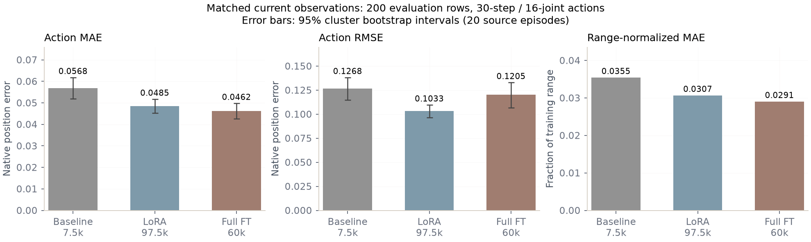
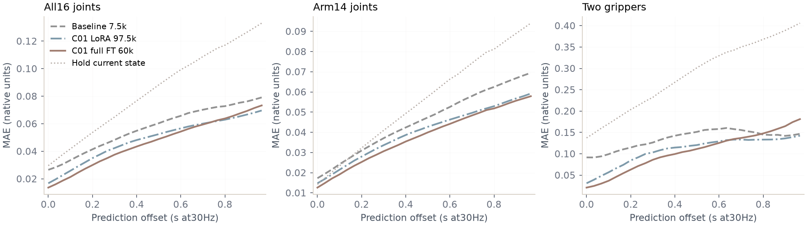
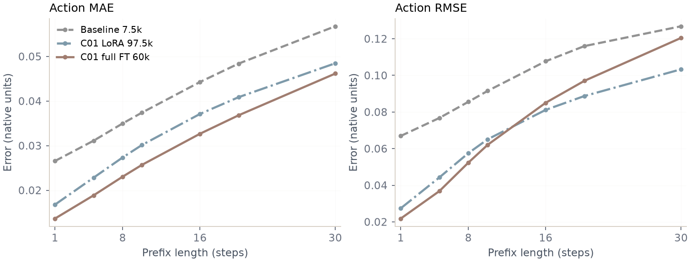
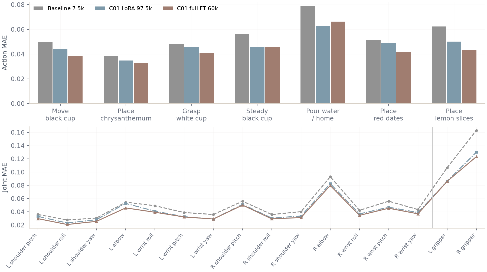
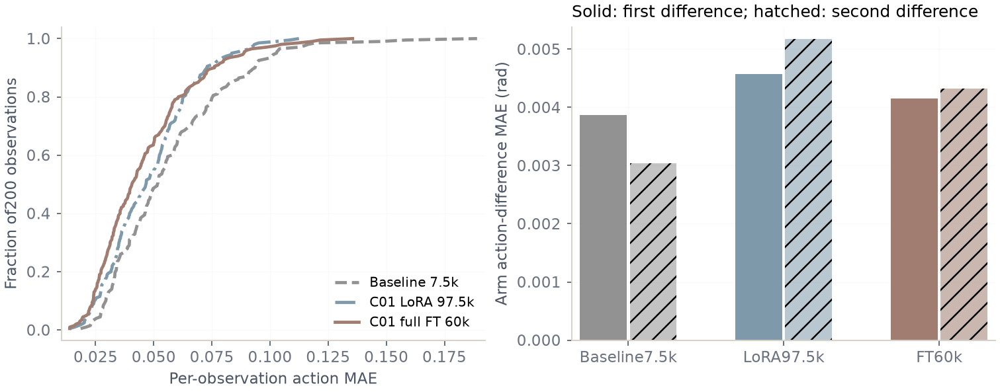
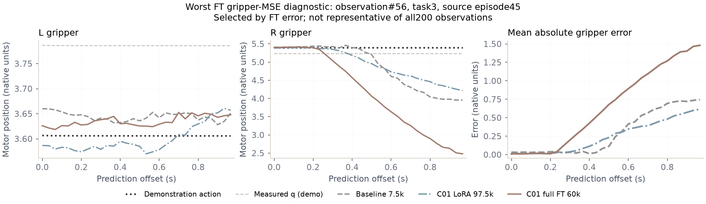
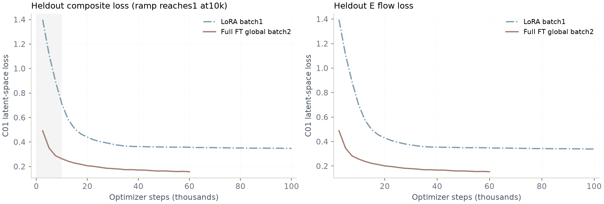
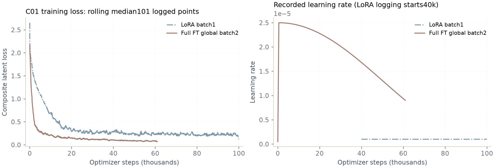

# G1D同观测动作对比与训练/迁移进度（2026-10-12）

## 1. 当前进度与使用的检查点

实查时间：**2026-10-12 10:14，Asia/Shanghai**。

- **A800 LoRA100k：已完成训练与评测**；按heldout composite loss选中97500。97500 loss0.34772306，100000 loss0.34784741；本报告明确采用97500，不混称为100000步参数。
- **A100双卡全量FT100k：61110/100000**；目前最优已提交检查点60000，验证loss0.15740303。本次完整动作生成评测采用**60000**；100k尚未完成，不能把本报告当作最终100k结果。
- **992446迁移：尚未完成**。Range改造前已校验4963/5016文件、11.658/39.309GB（约29.66%字节）。随后因TimeoutError停/重试；旧转发断开已恢复。
- 本轮增加HTTP Range保留.partial（实际后缀.transfer）续传，严格最终尺寸/SHA256一致才提交；通过真实206响应与已校验文件1024字节后切片一致性验证。目标新端口18203，后台恢复后计数会重新扫描，不表示已传内容被删除。
- 当前迁移快照state=running，supervisor=syncing；该值是本报告生成时快照，以目标ASSET_SYNC_STATUS与SYNC_SUPERVISOR_STATUS最新心跳为准。
- **迁移范围更正**：39.309GB清单中的assets/baseline7500只有历史预测与评测元数据，不是完整7500参数。完整baseline权重在sys01原checkpoint及HF模型库，入口由仓库ARTIFACTS.json记录。之前将该目录笼统称为baseline权重不准确。C01 LoRA40000/97500参数在主迁移清单内。
- TensorBoard sys01端转发重新启动于tmux g1d_tb_forward，实际tags API两路读回；A800 http://100.74.87.113:6008，A100 http://100.74.87.113:6009。
- A100 rank1已安排tmux g1d_matched_final_wait：等训练100k完成后，从已提交checkpoint中选最低heldout composite loss，再执行同一200条动作评测，输出run/matched_20261012/fullft100k_best和FULLFT100K_PI_SELECTION.json。当前仍在等待训练完成。

## 2. “相同observation”的验证范围

- 官方源episode划分：177 train /20 validation；固定100个subtask episode，每个2条评测记录，共200条、197个不同索引/观测；3个重复索引仍按原固定种子协议保留。
- 相同3视角RGB、当前16D实际关节状态、prompt；state统一官方quantile不裁剪，补齐32D；token长度200。
- baseline原输入处理路径逐条与C01核对：**200/200原始RGB像素、state、image mask和prompt token相同**。JAX与NumPy归一化图像最大误差为1.1920928955078125e-7（float32舍入）；保存了当前重建baseline输入路径的tensor hash及canonical hash，没有把这个差异宣称为位级相等。
- C01 LoRA与FT实际输入tensor SHA256 **200/200位级一致**。三组indices、task、mask、当前state、目标action和源episode均对齐，目标最大差为0。
- baseline复用原7500固定噪声预测，NPZ原SHA256=5cb9ca54a89c91d20f6daba2c5cdd3f2814d8973547aab51d86ebdff4b908ab5；先通过上述当前输入处理审计，再附加统一索引/valid mask。A800源baseline7500目录不含params，首次新加载失败后没有替换成另一个7500检查点。
- baseline原H32裁前30步；C01 H30；均比较物理**30×16绝对电机位置action**。10步denoise；每条种子20260924+ordinal。baseline noise32×32、C01 noise30×256，不能称为同一数值噪声。
- 4个短片段共有34个padding预测步，全部排除；有效5966个动作步×16维。差分指标只统计所有参与步都有效的位置。
- 推理只输入当前观测。未来示范action、实测state和E仅用于离线监督/评分，不输入策略。
- 单位是原生电机位置；双臂为rad，夹爪在本模型中是内部电机q，不是米或归一化0–1。范围不同，故另外给出双臂/夹爪及按训练q01/q99范围归一化的误差。

## 3. 完整30步窗口主要指标

所有位置误差越低越好；MAE/MSE/RMSE只统计有效步。

| 模型 | MAE | RMSE | MSE | 范围归一化MAE | P95绝对误差 | P99绝对误差 |
|---|---:|---:|---:|---:|---:|---:|
| π0.5 baseline7500 | 0.056769 | 0.126825 | 0.016084 | 0.035459 | 0.194896 | 0.495950 |
| C01 LoRA97500（100k已完成） | 0.048472 | 0.103323 | 0.010676 | 0.030696 | 0.162207 | 0.448880 |
| C01全量FT60000（100k任务进行中） | 0.046163 | 0.120471 | 0.014513 | 0.029058 | 0.144492 | 0.407459 |



- LoRA较baseline：MAE下降**14.62%**，RMSE下降**18.53%**。
- FT60k较baseline：MAE下降**18.68%**，RMSE点估计下降**5.01%**。
- FT60k较LoRA：MAE下降**4.76%**，但RMSE**上升16.60%**。FT多数位置更准，少数夹爪大偏差更严重；不能用较低E loss或MAE推出全面更强。
- FT60k P95/P99均更低但RMSE更高，说明问题主要落在更稀少的极端误差；JSON同时保留max error和每条观测误差，避免只看平均数。

### 双臂与夹爪分开统计

| 模型 | 双臂MAE | 双臂RMSE | 夹爪MAE | 夹爪RMSE |
|---|---:|---:|---:|---:|
| π0.5 baseline7500 | 0.045619 | 0.077717 | 0.134820 | 0.293933 |
| C01 LoRA97500（100k已完成） | 0.039954 | 0.064749 | 0.108096 | 0.236766 |
| C01全量FT60000（100k任务进行中） | 0.037813 | 0.062182 | 0.104610 | 0.298396 |

FT双臂MAE/RMSE均优于LoRA，整体RMSE退步主要来自夹爪；FT夹爪RMSE0.29840也略高于baseline0.29393。其夹爪平均误差更低，说明需要检查夹爪时序和少数异常动作，而不是笼统判断所有关节都不准。

### 配对不确定性

对20个原始source episode做2000次配对cluster bootstrap，保留同一episode内关联，seed20261012。不是把200个anchor当成200条独立episode，也不衡量不同训练seed/部署随机性的全部不确定性。

| 比较 | MAE下降点估计 | 95%区间 | RMSE下降点估计 | 95%区间 |
|---|---:|---|---:|---|
| C01 LoRA97500（100k已完成） vs π0.5 baseline7500 | 14.62% | [10.53%, 18.44%] | 18.53% | [11.49%, 23.95%] |
| C01全量FT60000（100k任务进行中） vs π0.5 baseline7500 | 18.68% | [14.75%, 22.58%] | 5.01% | [-7.16%, 15.08%] |
| C01全量FT60000（100k任务进行中） vs C01 LoRA97500（100k已完成） | 4.76% | [0.53%, 9.11%] | -16.60% | [-30.40%, -3.73%] |

FT对baseline的RMSE区间跨0，不宣称稳定优于baseline；FT对LoRA的RMSE下降区间整体为负，在这批已选择heldout上支持其长尾误差更差。以上是条件性离线统计，不是独立test上的泛化或因果结论。

## 4. 预测窗口内的误差



FT近端预测更好，但夹爪在预测后段误差增长更快。前8/10步与完整30步的结果不同：

| 模型 | 前8步MAE | 前8步RMSE | 前10步MAE | 前10步RMSE | 全30步RMSE |
|---|---:|---:|---:|---:|---:|
| π0.5 baseline7500 | 0.034985 | 0.085590 | 0.037414 | 0.091567 | 0.126825 |
| C01 LoRA97500（100k已完成） | 0.027357 | 0.057553 | 0.030154 | 0.065127 | 0.103323 |
| C01全量FT60000（100k任务进行中） | 0.023047 | 0.052375 | 0.025696 | 0.062116 | 0.120471 |



若实际控制只执行chunk前部后重新观察，不能把完整30步RMSE直接等同于实际闭环效果；反过来，前8步离线更好也不能证明机器人会成功。本轮没有调节真实执行长度或异步预取参数。

额外计算“保持当前实测q不动”的解析参考：MAE0.08401、RMSE0.20680，明显差于三组策略。这个参考不是完整任务控制策略，只用于检查低误差是否完全来自复制当前位姿。

## 5. 分阶段结果

| 阶段 | baseline MAE | LoRA MAE | FT60k MAE | baseline RMSE | LoRA RMSE | FT60k RMSE |
|---|---:|---:|---:|---:|---:|---:|
| 0 移动黑杯到中间 | 0.04965 | 0.04395 | 0.03826 | 0.11791 | 0.09533 | 0.08210 |
| 1 菊花放入黑杯 | 0.03861 | 0.03472 | 0.03291 | 0.07238 | 0.09031 | 0.06924 |
| 2 左手抓白杯 | 0.04833 | 0.04557 | 0.04116 | 0.10587 | 0.10062 | 0.11045 |
| 3 右手稳持黑杯 | 0.05603 | 0.04583 | 0.04596 | 0.11423 | 0.09111 | 0.13754 |
| 4 倒水并回位 | 0.07905 | 0.06265 | 0.06627 | 0.15749 | 0.11882 | 0.16263 |
| 5 红枣放入黑杯 | 0.05151 | 0.04877 | 0.04167 | 0.11397 | 0.10955 | 0.08860 |
| 6 柠檬片放入黑杯 | 0.06229 | 0.04999 | 0.04328 | 0.18238 | 0.12219 | 0.11155 |



- 移黑杯、菊花、红枣、柠檬：FT60k聚合MAE/RMSE均优于LoRA，首步原子能力值得做真机对照。
- 白杯抓取、稳持黑杯、倒水回位：FT60k RMSE比LoRA更差，其中稳持黑杯0.13754 vs LoRA0.09111，倒水0.16263 vs0.11882；这些阶段的大误差不能被总体MAE遮盖。
- 菊花：本次FT60k RMSE0.06924，低于baseline0.07238；LoRA0.09031较差。是这批离线动作指标的变化，不能宣称菊花真实抓取已成功。

## 6. 丝滑程度：原始chunk诊断

差分不除以真实执行dt，因此以下是Δq/Δ²q目标序列误差，单位仍为电机q，不是实测机器人速度/加速度。

| 模型 | 双臂Δq误差MAE | 双臂Δ²q误差MAE | 预测平均绝对Δ²q | 每关节每chunk反向次数 |
|---|---:|---:|---:|---:|
| π0.5 baseline7500 | 0.003869 | 0.003044 | 0.002666 | 4.26 |
| C01 LoRA97500（100k已完成） | 0.004574 | 0.005175 | 0.004934 | 7.42 |
| C01全量FT60000（100k任务进行中） | 0.004156 | 0.004323 | 0.004066 | 5.90 |

示范双臂平均绝对Δ²q约0.001154；baseline0.002666，LoRA0.004934，FT0.004066。两种C01虽然位置误差更低，原始chunk内部细碎变化比baseline多，FT较LoRA略改善。

反向次数只计算相邻Δq均超过0.001原生单位时的符号反转；它是启发式诊断，不是机器人震动测量，也未经过在线插值、限速、滤波和PD控制。



## 7. 同observation开环图

图中黑色点线是示范action，灰色baseline、蓝色LoRA、棕色FT，叉号是当前实测state。每图展示16个电机的未来30步目标。**这是固定真实观测上的单chunk开环预测，不是把预测回灌观测的自回归完整episode，也没有执行机器人。**

为避免挑选成功案例，7个阶段都使用固定评测列表中该任务的第一条观测，索引、source episode和frame记录在openloop_examples.json。相同当前3视角图像见06_observation_contact_sheet.png。

- [移动黑杯到中间：16维开环图](results/figures/openloop_task0_anchor000.png)，source episode=4，frame=60，ordinal=0。
- [菊花放入黑杯：16维开环图](results/figures/openloop_task1_anchor002.png)，source episode=4，frame=99，ordinal=2。
- [左手抓白杯：16维开环图](results/figures/openloop_task2_anchor004.png)，source episode=4，frame=52，ordinal=4。
- [右手稳持黑杯：16维开环图](results/figures/openloop_task3_anchor006.png)，source episode=4，frame=5，ordinal=6。
- [倒水并回位：16维开环图](results/figures/openloop_task4_anchor008.png)，source episode=4，frame=69，ordinal=8。
- [红枣放入黑杯：16维开环图](results/figures/openloop_task5_anchor072.png)，source episode=70，frame=74，ordinal=72。
- [柠檬片放入黑杯：16维开环图](results/figures/openloop_task6_anchor132.png)，source episode=142，frame=80，ordinal=132。

### 大偏差诊断：稳持黑杯时的夹爪目标

另选FT夹爪MSE最大的ordinal56、dataset index7471、task3、source episode45；该图是故障诊断，不代表全部数据平均情况。



示范右夹爪目标约5.4保持，FT在后段降至约2.48，最大单点偏差约2.919。这类提前改变夹爪目标的行为值得现场核查。没有根据电机q方向直接宣布张开/闭合或推断已掉杯。

## 8. 训练曲线及后续判断





这里只比较C01的相同E空间训练目标。π0.5 baseline动作空间loss不与E空间loss混画。前10k的aux ramp变化和不同global batch/LR预算已标出；训练loss图是101个日志点滚动中位数，不是每步raw loss或验证误差。

1. FT60k具备更好的近端/双臂动作预测，继续已授权100k训练计划；下一阶段重点核查夹爪后段时序、稳杯与倒水。
2. LoRA97500在完整30步RMSE及夹爪极端误差方面更稳，保留为对照；不能据整体MAE立即替换全部任务。
3. 真机对比应固定初始物体布局、实测柱高/腰部姿态、相机、gravity、执行步数、预取/插值参数，再报告progress/10、成功率和人工介入。当前离线指标不能回答长程任务成功率。
4. 单个训练seed、已用于选点的heldout、更新步数/样本量不一致，因此不是等预算、独立test或多seed对照。后续100k最终结果会单独标检查点，不覆盖当前60k快照。

## 9. 文件与复现

- [完整指标JSON](results/metrics.json)：MAE/MSE/RMSE、bias、中位数/P90/P95/P99/max、范围归一化、各关节R²/Pearson、各任务/预测步/观测误差、近端窗口、Δq/Δ²q/Δ³q、反向计数、动作起始state偏差和cluster bootstrap。
- [总体CSV](results/overall.csv)、[任务CSV](results/by_task.csv)、[关节CSV](results/by_joint.csv)、[预测步CSV](results/by_horizon.csv)、[观测CSV](results/by_observation.csv)、[分组/差分CSV](results/by_group_temporal.csv)、[配对CI CSV](results/paired_bootstrap.csv)。
- [所有16幅图的PDF](results/ALL_FIGURES.pdf)，单图PNG/PDF在results/figures，图表清单figure_catalog.json记录源数据/生成脚本/视觉检查。
- raw/A800/run/matched_20261012与raw/A100/run/matched_20261012：三组predictions.npz、各自产生的元数据、baseline INPUT_AUDIT及选定观测PNG。
- [比较协议](results/metric_contract.json)、[PLAN.md](PLAN.md)、[CHECKLIST.md](CHECKLIST.md)、脚本../../../scripts/evaluate_matched.py /../../../scripts/audit_baseline_inputs.py /analyze_actions.py。

分析复现（绘图不导入JAX或访问GPU）：

```bash
uv venv .venv --python 3.12
uv pip install --python .venv/bin/python numpy matplotlib pillow scipy
.venv/bin/python analyze_actions.py
```

完整新C01动作生成需项目兼容JAX/Flax运行环境，参考evaluate_matched.py的--params/--cache/--validation/--norm-stats/--variant参数；原始命令日志留在远程matched_eval_20261012.log。原baseline未归档逐观测图像tensor哈希，本次审计验证的是当前文件上的原处理路径与C01的一致性，baseline神经模型没有重新加载推理；历史包的预测/目标与来源SHA256已核验。报告中的时延记录包含编译及并发训练影响，不做硬件公平的推理速度排名。
